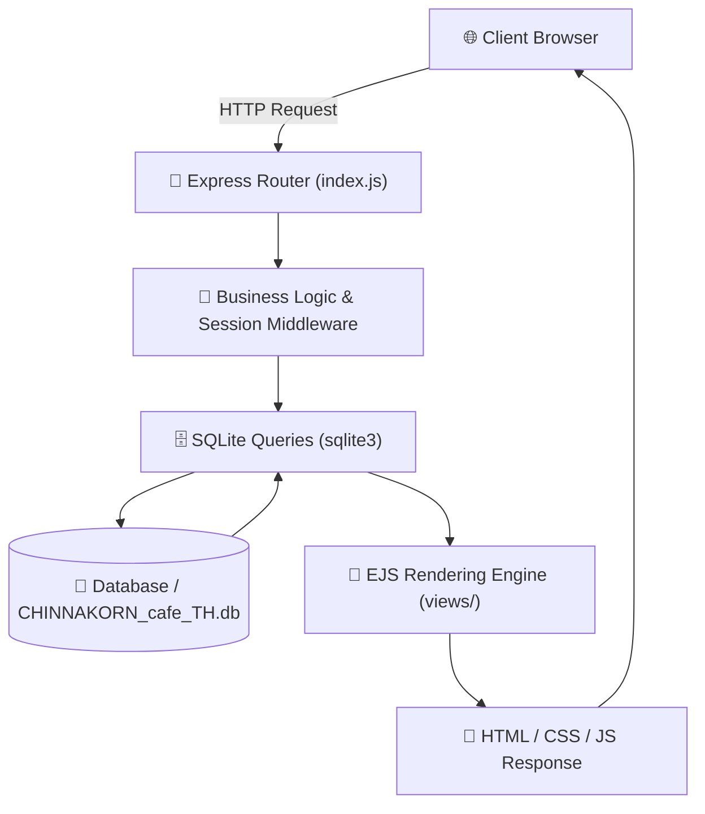

# ☕ CHINNAKORN Cafe (ชินกร คาเฟ่)


> 🎓 **2568 Academic Project** — Full-stack Web Application for Café POS, Customer Ordering, and Inventory Management.

---

## 🌟 About (เกี่ยวกับโครงการ)

### 🇹🇭 ภาษาไทย
**CHINNAKORN Cafe (ชินกร คาเฟ่)** เป็นระบบเว็บแอปพลิเคชันบริหารจัดการร้านกาแฟและสั่งเครื่องดื่มแบบครบวงจร (Full-Stack Cafe Web Application) พัฒนาขึ้นเพื่อจำลองและสนับสนุนการดำเนินงานจริงของธุรกิจคาเฟ่ยุคใหม่ โดยมุ่งเน้นการเชื่อมโยงประสบการณ์การสั่งซื้อของลูกค้า (Customer Experience) เข้ากับการทำงานหน้าร้านและหลังร้านของพนักงาน (Staff Operations) ได้อย่างราบรื่นไร้รอยต่อ

**จุดเด่นและบทบาทของระบบ:**
1. **สำหรับลูกค้า (Customer-Facing):** 
   - สามารถเลือกรูปแบบการรับประทานได้ทั้ง **ทานที่ร้าน (Dine-in)** หรือ **สั่งกลับบ้าน (Takeaway)**
   - เลือกดูรายการเมนูเครื่องดื่ม เบเกอรี่ และของหวาน พร้อมปรับแต่งตัวเลือกตามใจชอบ (เช่น ระดับความหวาน, ขนาดแก้ว, ท็อปปิ้ง)
   - มีระบบตะกร้าสินค้าแบบ Session-based ตรวจสอบยอดรวม และชำระเงินสะดวกผ่าน **PromptPay QR Code**
2. **สำหรับพนักงานและผู้ดูแล (Staff & Management):**
   - **Cashier Interface:** หน้าจอสำหรับพนักงานคิดเงิน ช่วยรับออเดอร์หน้าร้าน บันทึกรายการ และออกใบสรุปคำสั่งซื้อ
   - **Barista Interface:** หน้าจอแสดงคิวคำสั่งซื้อแบบ Real-time ช่วยให้บาริสต้าเตรียมเครื่องดื่มตามลำดับได้อย่างแม่นยำ
   - **Inventory Management:** ระบบตัดสต็อกวัตถุดิบอัตโนมัติตามสูตรของแต่ละเมนู และหน้าจัดการคลังสินค้าคงเหลือ

---

### 🇬🇧 English
**CHINNAKORN Cafe** is a full-stack web application designed to streamline the day-to-day operations of a modern café. It bridges customer self-ordering workflows with internal staff operations—from cashier point-of-sale (POS) and barista queue fulfillment to automated recipe-based ingredient inventory tracking.

Developed as an academic web programming project, the application demonstrates server-side rendering (SSR) using **Node.js**, **Express.js**, and **EJS**, backed by persistent **SQLite** storage and instant cashless payment generation via **PromptPay QR**.

---

## 📖 Project Overview

**CHINNAKORN Cafe** is built with a server-side rendered architecture. It serves as both a customer-facing digital ordering menu and an internal back-office management tool. 

The project is built using:
- **Backend:** Node.js with Express.js framework
- **Templating Engine:** EJS (Embedded JavaScript) for dynamic views
- **Styling:** Custom responsive CSS3 layouts
- **Database:** SQLite3 for persistent data management
- **Payments:** Dynamic Thai PromptPay QR code generation (`promptpay-qr` & `qrcode`)

---

## ✨ Features

- 🏠 **Entry & Dining Mode Selection** — Select between Dine-in and Takeaway before ordering
- 📋 **Menu Browsing & Customization** — Explore drinks and bakery items with dynamic options (sweetness level, sizes, additions)
- 🛒 **Session-Based Cart System** — Smooth shopping cart management for both customers and cashiers
- 💳 **PromptPay QR Payment** — Integrated instant QR code generation for digital payment
- 🧾 **Order Confirmation & Tracking** — Unique order identification with real-time status tracking
- ☕ **Barista Queue Interface** — Dedicated view for baristas to view incoming orders and fulfill them
- 💼 **Cashier POS Interface** — Front-desk interface for staff to take orders directly
- 📦 **Inventory & Ingredient Deduction** — Automatic deduction of raw ingredients per ordered menu recipe
- 📱 **Responsive Design** — Accessible across desktops, tablets, and mobile devices

---

## 🗂 Project Structure

```
Chinnakorn-Cafe/
│
├── .gitignore                          # Git ignore rules (node_modules, logs, etc.)
├── README.md                           # Project documentation & overview
│
├── docs/                               # Project reports & presentation documents
│   └── W-10-Report.pdf                 # Full project report (89-page PDF document)
│
└── code_ing/                           # Main application source code
    │
    ├── Database/                       # SQLite database files & schemas
    │   ├── CHINNAKORN_cafe_TH.db       # Primary database (Thai localization)
    │   ├── CHINNAKORN_cafe_EN.db       # Alternative database (English localization)
    │   ├── CHINNAKORN_blueprint.db     # Base blueprint database
    │   └── CHINNAKORN_blueprint.sql    # Database schema & seed SQL
    │
    ├── public/                         # Static assets served by Express
    │   ├── menu_pictures/              # SVG illustrations of drinks & bakery items
    │   ├── picture/                    # Icons and menu graphical assets
    │   ├── pictures/                   # Logo and branding assets
    │   ├── script_*.js                 # Client-side JavaScript (cart, modals, inventory)
    │   └── style_*.css                 # CSS stylesheets for all pages
    │
    ├── views/                          # Server-side rendered EJS templates
    │   ├── where_to_eat.ejs            # Landing / Dine-in vs Takeaway selector
    │   ├── main.ejs                    # Main café landing page
    │   ├── selecting_menu.ejs          # Interactive menu selection page
    │   ├── selecting_menu_header.ejs   # Reusable menu navigation header
    │   ├── cart.ejs                    # Customer shopping cart
    │   ├── confirm_order.ejs           # Staff order confirmation
    │   ├── confirm_order-customer.ejs  # Customer order confirmation
    │   ├── pay_qr.ejs                  # Staff QR payment view
    │   ├── pay_qr-customer.ejs         # Customer QR payment view
    │   ├── payment_success.ejs         # Staff payment success view
    │   ├── payment_success-customer.ejs# Customer payment success view
    │   ├── inventory_for_barrista.ejs  # Barista queue & inventory interface
    │   ├── inventory_for_cashier.ejs   # Cashier POS order & stock interface
    │   ├── main_for_cashier.ejs        # Cashier dashboard
    │   ├── main_for_cashier_before.ejs # Cashier initialization page
    │   └── main_for_customer.ejs       # Customer dashboard
    │
    ├── index.js                        # Main Express server, routing & database logic
    ├── package.json                    # Project dependencies & configurations
    ├── package-lock.json               # Dependency lockfile
    ├── setup.js                        # Node.js automated setup script
    ├── setup.bat                       # Windows 1-click setup script
    └── setup.sh                        # Unix/Linux/macOS 1-click setup script
```

---

## ⚙️ Installation & Setup

### Prerequisites

Make sure you have Node.js and npm installed:

| Tool | Version | Download |
|------|---------|----------|
| **Node.js** | v18+ (tested on v18, v20, v24) | [nodejs.org](https://nodejs.org) |
| **npm** | v8+ | Bundled with Node.js |

---

### Step-by-Step Setup

1. **Clone the repository**
   ```bash
   git clone https://github.com/pngkcwtk/Chinnakorn-Cafe.git
   cd Chinnakorn-Cafe/code_ing
   ```

2. **Install dependencies**
   ```bash
   npm install
   ```

   > [!TIP]
   > On Windows machines, if native SQLite3 binary issues occur, run:
   > ```bash
   > npm rebuild sqlite3
   > ```

3. **Configure the Database**
   - SQLite3 databases (`CHINNAKORN_cafe_TH.db`, etc.) are pre-configured inside the `Database/` directory.
   - No external database installation (e.g. MySQL/PostgreSQL) is required!

4. **Run the Application**
   ```bash
   node index.js
   ```

   Or with auto-reload during development:
   ```bash
   npx nodemon index.js
   ```

---

## 🚀 Usage

Once the server is running, open your web browser and navigate to:

```
http://localhost:3000
```

### Key Routes

| Route | Method | Description |
|-------|--------|-------------|
| `/` | GET | Entry page (Select Dine-in / Takeaway) |
| `/menu` | GET | Menu selection page with option customization |
| `/cart` | GET | Shopping cart review |
| `/confirm-order` | GET / POST | Order confirmation and checkout |
| `/payment` | GET | Dynamic PromptPay QR Code payment |
| `/payment-success` | GET | Order receipt & payment completion |
| `/inventory-barista` | GET | Barista preparation queue & stock monitor |
| `/inventory-cashier` | GET | Cashier order intake & inventory overview |
| `/where-to-eat` | GET | Dining preferences selection |

---

## 📊 System Architecture & Data Flow



---

## 🧠 Architectural Design (MVC Pattern)

This project follows a simplified **Model-View-Controller (MVC)** architectural design:

| Layer | Role | Technology |
|-------|------|------------|
| **Model** | Data storage, queries, and schema definition | SQLite (`sqlite3`) |
| **View** | Dynamic UI layout and presentation | EJS templates + Custom CSS |
| **Controller** | Request processing and application logic | Node.js route handlers in `index.js` |
| **Session** | Cart and state management | `express-session` |

---

### Database Schema (Key Tables)

| Table | Description |
|-------|-------------|
| `Menu` | Menu items, names, prices, and status |
| `Category` | Menu categories (Coffee, Tea, Milk, Bakery, etc.) |
| `Order` | Customer order records, total price, and fulfillment status |
| `OrderItem` | Items associated with each order |
| `OrderItemOption` | Specific customizations selected for each item |
| `OptionGroup` | Customization groups (e.g., Sweetness, Cup Size, Temperature) |
| `ItemOption` | Available choices within each group |
| `Ingredient` | Raw materials with stock quantity tracking |
| `MenuIngredient` | Recipe mapping between menu items and raw ingredients |

---

## 🛠 Tech Stack

### Backend
- [Node.js](https://nodejs.org/) — JavaScript Runtime
- [Express.js](https://expressjs.com/) — Web framework & routing
- [sqlite3](https://www.npmjs.com/package/sqlite3) — Embedded database engine
- [express-session](https://www.npmjs.com/package/express-session) — Session state management
- [cookie-parser](https://www.npmjs.com/package/cookie-parser) — HTTP cookie parser
- [promptpay-qr](https://www.npmjs.com/package/promptpay-qr) — Thai PromptPay QR payload generator
- [qrcode](https://www.npmjs.com/package/qrcode) — QR code image generator

### Frontend
- **EJS** — Embedded JavaScript templates for dynamic rendering
- **CSS3** — Custom modern stylesheets and responsive grid/flexbox layouts
- **Vanilla JavaScript** — DOM manipulation, modals, and interactive cart controls

---

## 📈 Evaluation & Summary

| Feature / Goal | Status |
|----------------|--------|
| Interactive Menu Browsing & Customization | ✅ Achieved |
| Session-based Cart (Customer & Cashier) | ✅ Achieved |
| Real-time Ingredient Stock Deduction | ✅ Achieved |
| Dynamic PromptPay QR Code Generation | ✅ Achieved |
| Barista & Cashier Dashboards | ✅ Achieved |
| Responsive UI across Devices | ✅ Achieved |
| Standalone SQLite Persistence | ✅ Achieved |

---

## 👥 Authors & Credits

| Field | Info |
|-------|------|
| 👤 **Authors** | [@pngkcwtk](https://github.com/pngkcwtk) & [@Varanapat](https://github.com/Varanapat) |
| 🎓 **Course** | 06066302 Fundamental Web Programming (2568) |
| 🏫 **Department** | Data Science and Business Analytics (DSBA), KMITL |
| 📄 **Report** | [PDF Document](./docs/W-10-Report.pdf) |
| 🎥 **Video Demo** | [YouTube Project Presentation](https://youtu.be/W1cmUQQcVVk) |
| 📁 **Project** | **CHINNAKORN Cafe** |

---

<div align="center">

Made with ☕ & ❤️ for **CHINNAKORN Cafe** (2568)

</div>
